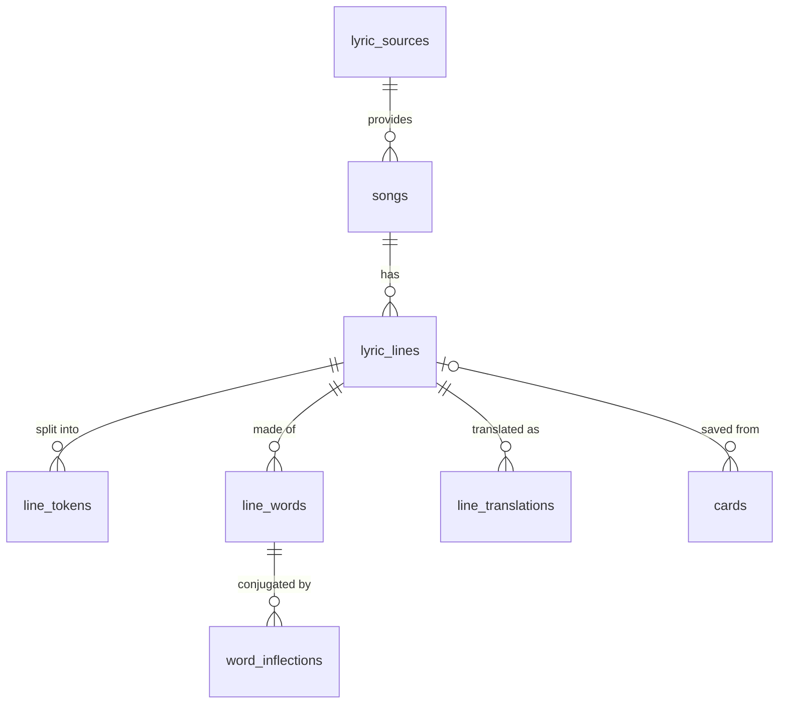

# Data model

How Utanabi stores songs, lyrics, words, meanings, grammar, conjugation, and flashcards. This is the plan the migrations follow. Each table arrives with the issue that first needs it.

## Three levels of a song

| Level | Table | What it is | Used for |
| --- | --- | --- | --- |
| **Line** | `lyric_lines` | One sung line: 君の声を探している | Building and showing the song. The example sentence on a card. |
| **Word** | `line_words` | One learnable unit: 探している, as the word 探す in the 〜ている form | Tapping, looking up, explaining, saving to a card. |
| **Token** | `line_tokens` | One piece from the tokenizer: 探し, て, いる | Furigana, and nothing else. |

A line is the sentence unit for songs and cards. A lyric line isn't always a grammatical sentence, but it's how songs are sung and read, and a card can show the line before and after it for context.

Words and tokens are different because a tokenizer cuts finer than a learner thinks. 探している comes out as three tokens, but it's one word to learn: 探す (to search), conjugated into 〜ている (is doing).

## The rules

1. **Store each fact once, at its source. Compute everything you can derive.**
    - **The line text is stored exactly as sung,** conjugations and all.
    - **Readings are stored** per token, because tokenizers guess wrong on lyrics (運命 sung as さだめ).
    - **Each word's analysis is stored:** its dictionary form, which meaning it has here, what grammar it carries, and its conjugation steps. A tokenizer guesses these, and the user can correct them.
    - **Romaji is never stored.** It comes from the readings.
    - **Furigana is never stored as markup.** It comes from each token's surface and reading.
    - **Conjugation tables are never stored.** Every form of 探す is computed in Go from the dictionary form and the verb class.
    - **Example sentences for a card are never stored.** They're found with a query: every line where that word, with that meaning, appears.
2. **The database refuses bad data.** Every table is `STRICT`. Foreign keys, `CHECK` limits, `UNIQUE` rules, and partial unique indexes back up the checks in Go.
3. **Text is normalized before it is saved.** Unicode NFC everywhere. Half-width katakana becomes full-width. Readings are hiragana only.
4. **Every row from an outside source says where it came from,** so community lyrics can be refreshed, or removed if a source is switched off (#7).
5. **Times are UTC, in integer milliseconds.**
6. **Your data and reference data live in different files.** `utanabi.db` holds your songs, analyses, and cards, and changes only through migrations. `dictionary.db` holds the dictionary and the grammar list. It's read-only, and an app update replaces it whole. Rows in `utanabi.db` refer to it by IDs that never change: the JMdict entry number, and grammar point IDs that are never renamed or reused.
7. **Every analysis says who made it:** `auto` (the tokenizer) or `user` (you corrected it). Running a better tokenizer later never overwrites a `user` analysis.
8. **Rules that span rows are triggers.** A word must end on a token that exists, words in a line must not overlap, and conjugation steps must count up from 0 with no gaps. Triggers in the migration refuse anything else.
9. **IDs that others point at are never reused.** `songs`, `lyric_lines`, `line_words`, and `cards` use `AUTOINCREMENT`, so an old link or reference can't land on a different row.

The schema is in `internal/store/migrations/002_songs.sql` and `003_learning.sql`. `internal/store/schema_integration_test.go` proves each rule: it fills in one fully analysed line, then checks that each kind of bad row is refused for the right reason, and that deleting a song removes everything learned from it.

## Your data: `utanabi.db`

### `lyric_sources`

| Column | Type | Rules |
| --- | --- | --- |
| `code` | TEXT, primary key | `user`, `lrclib`, `netease`, `qqmusic`. A table, not a `CHECK` list, so a new source is one `INSERT`. |
| `name` | TEXT | Shown in the app: "Your lyrics", "LRCLIB". |

### `songs`

| Column | Type | Rules |
| --- | --- | --- |
| `id` | INTEGER, primary key, `AUTOINCREMENT` | Never reused. |
| `title` | TEXT | 1 to 200 characters. |
| `title_reading` | TEXT, nullable | Kana, for sorting. |
| `artist` | TEXT | 0 to 200 characters. |
| `duration_ms` | INTEGER, nullable | Above 0. Used to match songs at a source. |
| `source` | TEXT, references `lyric_sources` | |
| `source_ref` | TEXT, nullable | The source's own ID. Null exactly when `source` is `user`. `UNIQUE (source, source_ref)`. |
| `created_at`, `updated_at` | INTEGER | |

### `lyric_lines`

| Column | Type | Rules |
| --- | --- | --- |
| `song_id` | INTEGER, references `songs`, cascade | |
| `position` | INTEGER | 0, 1, 2 within the song. `UNIQUE (song_id, position)`. |
| `stanza` | INTEGER | Goes up by one at each verse break. Blank lines aren't stored. |
| `text` | TEXT | The line as sung, NFC. 1 to 500 characters. |
| `start_ms` | INTEGER, nullable | From synced lyrics. |

### `line_tokens`

Only what furigana needs.

| Column | Type | Rules |
| --- | --- | --- |
| `line_id` | INTEGER, references `lyric_lines`, cascade | |
| `position` | INTEGER | `UNIQUE (line_id, position)`. |
| `surface` | TEXT | Exactly as written in the line. |
| `reading` | TEXT, nullable | Hiragana. Null for punctuation and Latin text. |
| `reading_source` | TEXT | `auto` or `user`. |

**Always true:** a line's token surfaces, in order, join back into exactly its `text`.

### `line_words`

The learnable units of a line. Each covers a run of tokens.

| Column | Type | Rules |
| --- | --- | --- |
| `line_id` | INTEGER, references `lyric_lines`, cascade | |
| `first_token`, `last_token` | INTEGER | The token positions it covers. `first_token <= last_token`. `UNIQUE (line_id, first_token)`. |
| `kind` | TEXT | `content` (noun, verb, adjective, adverb), `particle`, `expression` (a set phrase), or `auxiliary` (a grammar word that stands alone, like だ or です). |
| `lemma` | TEXT | The dictionary form: 探す for 探している, 美しい for 美しかった. |
| `lemma_reading` | TEXT, nullable | Hiragana: さがす. Null for words in Latin letters, such as "love" in a J-pop line. |
| `conj_class` | TEXT, nullable | How the word conjugates, a JMdict code: `v5s` (godan, す), `v1` (ichidan), `vs-i` (する), `vk` (来る), `v5k-s` (行く), `adj-i`, `adj-ix` (いい), `adj-na`, and so on. Null for words that don't conjugate. The database checks the code's shape; Go checks it against the full list, so a new code needs no table rebuild. |
| `entry_id` | INTEGER, nullable | The JMdict entry. Null for particles and words the dictionary doesn't have. |
| `sense_index` | INTEGER, nullable | **Which meaning applies in this line.** 光る means "to shine", but also "to stand out". Set only with `entry_id`. |
| `grammar_point_id` | TEXT, nullable | **What a particle or expression does here,** for example `ni-place` for に in 空に. |
| `analysis_source` | TEXT | `auto` or `user`. |

`CHECK` rules: a `particle` has a `grammar_point_id`. A `sense_index` needs an `entry_id`.

**Always true:**
- The words of a line don't overlap.
- Every token that isn't punctuation belongs to exactly one word.

### `word_inflections`

How a word got from its dictionary form to the form in the line. The steps are ordered, because Japanese stacks conjugations.

| Column | Type | Rules |
| --- | --- | --- |
| `word_id` | INTEGER, references `line_words`, cascade | |
| `step` | INTEGER | 0, 1, 2 in the order they apply. Primary key `(word_id, step)`. |
| `grammar_point_id` | TEXT | A `conjugation` grammar point: `te-form`, `teiru`, `past`, `negative`, `polite`, `potential`, `passive`, `causative`, `volitional`, `conditional-ba`, `conditional-tara`, `imperative`, and the rest of the list. |

Examples:

| As sung | Dictionary form | Steps |
| --- | --- | --- |
| 探している | 探す (`v5s`) | `te-form`, `teiru` |
| 光った | 光る (`v5r`) | `past` |
| 美しかった | 美しい (`adj-i`) | `past` |
| 行こう | 行く (`v5k-s`) | `volitional` |
| 会えない | 会う (`v5u`) | `potential`, `negative` |
| 食べさせられなかった | 食べる (`v1`) | `causative`, `passive`, `negative`, `past` |
| 待ってる | 待つ (`v5t`) | `te-form`, `teru` (spoken short form of `teiru`) |
| 消えぬ | 消える (`v1`) | `nu` (old negative, common in songs) |

An unconjugated word has no rows here.

### `line_translations`

A translation of a line, written as a sentence. There are three kinds of English for a line, and the database keeps them apart:

| Kind | Example for 夜の空に星が光る | Where it lives |
| --- | --- | --- |
| **Word-by-word gloss** | 夜 night · の 's · 空 sky · に in · 星 star · が (subject) · 光る shine | **Never stored.** Computed from `line_words` and the dictionary, so it always matches the analysis. |
| **Literal translation** | Night's sky in, the stars shine | A row with `style = 'literal'`: a sentence that follows the Japanese words and order. |
| **Natural translation** | Stars shine in the night sky | A row with `style = 'natural'`: fluent English. |

Each row also says who wrote it, so an AI translation can never pass for yours:

| Column | Type | Rules |
| --- | --- | --- |
| `line_id` | INTEGER, references `lyric_lines`, cascade | |
| `lang` | TEXT | `en` for now. |
| `style` | TEXT | `literal` or `natural`. |
| `origin` | TEXT | `user` (you), `ai` (a language model), or `source` (a lyrics source, such as NetEase, which has translated lyrics). |
| `model` | TEXT, nullable | The AI model that wrote it. Set exactly when `origin` is `ai`, so it can be traced and redone with a better model. |
| `source` | TEXT, nullable, references `lyric_sources` | The lyrics source it came from. Set exactly when `origin` is `source`. |
| `text` | TEXT | 1 to 1000 characters. |
| `created_at` | INTEGER | UTC milliseconds. |

`UNIQUE (line_id, lang, style, origin)`: one of each per line and language. A line can have your natural translation, an AI literal one, and an AI natural one side by side. When more than one of the same style exists, the app shows yours first, then a source's, then the AI's, and labels which it is.

AI translation itself (which model, where its key lives, and its off switch, like `lyrics_sources`) comes with its own issue. A key can't ship in the app, so it needs a server we run or the user's own key in the OS keychain.

### `cards`

Your flashcards. Three kinds.

| Column | Type | Rules |
| --- | --- | --- |
| `id` | INTEGER, primary key | |
| `kind` | TEXT | `word`, `grammar`, or `line`. |
| `entry_id`, `sense_index` | INTEGER, nullable | A `word` card: one meaning of one dictionary word. |
| `grammar_point_id` | TEXT, nullable | A `grammar` card: one use of a particle, one conjugation, or one pattern. |
| `line_id` | INTEGER, nullable, references `lyric_lines`, cascade | A `line` card's line. The card goes when the line goes. |
| `context_line_id` | INTEGER, nullable, references `lyric_lines`, `ON DELETE SET NULL` | The line a `word` or `grammar` card was saved from. The card stays when the line goes. |
| `label`, `label_reading` | TEXT | A copy of the word or pattern as saved (光る, ひかる), so the card reads correctly if the dictionary changes or the song is deleted. |
| `created_at` | INTEGER | |

`CHECK` rules give each kind exactly the columns it needs. Partial unique indexes keep one card per target:
- one `word` card per `(entry_id, sense_index)`
- one `grammar` card per `grammar_point_id`
- one `line` card per `line_id`

**A word in five songs is one card** with five example lines, found by a query on `line_words`.

What a card shows:

| Kind | Front | Back |
| --- | --- | --- |
| `word` | 光る, highlighted in a line from your songs | Reading and romaji, the meaning used in the song, the other meanings, and its conjugation class |
| `grammar` | The line, with に or 〜ている highlighted | What it does ("place: where something happens"), with the rule for forming it |
| `line` | 夜の空に星が光る | The natural English, the literal English, the word-by-word gloss, and its conjugations explained, each labelled with who wrote it |

Review scheduling gets its own table when #12 decides how review works.

## Reference data: `dictionary.db`

Built from JMdict and our own grammar list, shipped with the app, and replaced whole on update. Never written to by the app.

| Table | Holds |
| --- | --- |
| `entries` | One row per JMdict entry. `id` is JMdict's own entry number. |
| `entry_forms` | Every spelling of an entry, kanji and kana (光る, ひかる), with JMdict's priority, for lookup. |
| `senses` | Each meaning of an entry: `(entry_id, sense_index)`, the English glosses, the part of speech and conjugation class codes (JMdict tags each sense, for example `v5r`), and notes such as "usually written in kana". |
| `grammar_points` | Our own list, written by hand. One row per **use** of a particle, per conjugation, and per pattern. |

### `grammar_points`

| Column | Rules |
| --- | --- |
| `id` | A stable slug: `ga-subject`, `wa-topic`, `ni-place`, `ni-time`, `ni-target`, `no-possession`, `te-form`, `teiru`, `past`, `potential`. Never renamed or reused. |
| `kind` | `particle`, `conjugation`, or `pattern`. |
| `pattern` | How it's written: が, に, 〜ている, 〜た. |
| `title` | Short: "Subject marker", "Place", "Ongoing action". |
| `meaning` | One plain sentence for a card. |
| `explanation` | A longer explanation for the grammar screen. |
| `formation` | For conjugations: how it's formed from each conjugation class, in words. The code that does it lives in Go. |
| `standard_id` | For spoken, short, or old forms: the standard form it stands for. `teru` points to `teiru`, `chau` to `te-shimau`. |

**A particle has one row per use,** because that is where its meaning lives. に has rows for place, time, target, and purpose. The word in the line points at the one it is.

The first list covers the common particles, every conjugation, and the patterns songs use most: roughly 60 to 100 rows. It grows as songs need more.

## What is computed, and where

| Shown | Computed from | Where |
| --- | --- | --- |
| Furigana | Each token's `surface` and `reading` (kana at the end is matched and left bare) | Go, sent to the app as ruby pieces |
| Romaji | Token readings | One Hepburn function in Go, unit-tested |
| Every form of a verb or adjective | `lemma` and `conj_class` | A conjugator in Go, tested against a table that includes the irregular verbs (する, 来る, 行く, ある, いい) and song forms (〜てる, 〜ちゃう, ら抜き, 〜ぬ) |
| "探す in the 〜ている form" | `lemma` and `word_inflections` in order | Go |
| Example lines for a card | `line_words` with the same entry and sense, or the same grammar point | A query |
| Word-by-word gloss of a line | Each word's `entry_id` and `sense_index` (the meaning used here), and each particle's grammar point | Go, from `line_words` and `dictionary.db` |
| Verse breaks | A change in `stanza` | The app |
| Search | Titles, artists, line text, readings, dictionary forms | Later: an FTS5 index with the trigram tokenizer |

## How it rolls out

| Migration | Adds | Status |
| --- | --- | --- |
| 002 | `lyric_sources` (with its four rows), `songs`, `lyric_lines` | Built. The songs slice uses it. |
| 003 | `line_translations`, `line_tokens`, `line_words`, `word_inflections`, `cards` | Built. The tables are ready, with their rules tested; the code that fills them comes with #8, #9, #11, and #12. |
| `dictionary.db` | `entries`, `entry_forms`, `senses`, `grammar_points` | With #9: it needs a JMdict importer and the grammar list. |

New columns or tables only come in a new migration file. A merged migration is never edited. `dictionary.db` has its own version number, checked at startup.

## Dependencies and content

- `golang.org/x/text`, for Unicode normalization (`internal/common/jtext`). The standard library doesn't have it.
- A tokenizer for #8 (for example kagome, pure Go, with its dictionary bundled).
- JMdict, under its licence (CC BY-SA 4.0), which requires credit in the app.
- The `grammar_points` list, which we write ourselves.
