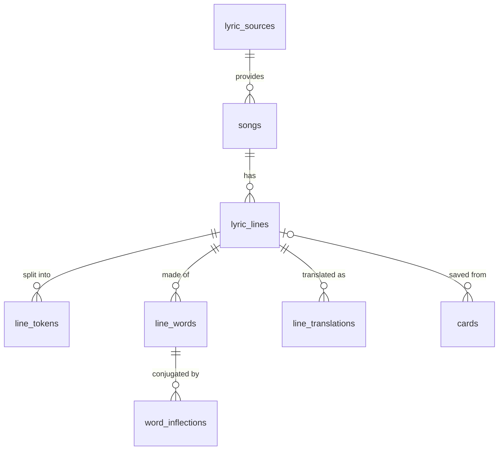

# Data model

How Utanabi stores songs, lyrics, words, meanings, grammar, conjugation, and flashcards. This is the plan the migrations follow. Each table arrives with the issue that first needs it.

## Three levels of a song

| Level | Table | What it is | Used for |
| --- | --- | --- | --- |
| **Line** | `lyric_lines` | One sung line: 君の声を探している | Building and showing the song. The example sentence on a card. |
| **Word** | `line_words` | One learnable unit: 探している, as the word 探す in the 〜ている form | Tapping, looking up, explaining, saving to a card. |
| **Token** | `line_tokens` | One piece from the tokenizer: 探し, て, いる | Furigana, and nothing else. |

A line is the sentence unit for songs and cards. A lyric line isn't always a grammatical sentence, but it's how songs are sung and read, and a card can show the line before and after it for context.

Words and tokens are different because a tokenizer cuts finer than a learner thinks. 探している comes out as three tokens, but it's one word to learn: 探す (to search), conjugated into 〜ている (is doing).

## The rules

1. **Store each fact once, at its source. Compute everything you can derive.**
    - **The line text is stored exactly as sung,** conjugations and all.
    - **Readings are stored** per token, because tokenizers guess wrong on lyrics (運命 sung as さだめ).
    - **Each word's analysis is stored:** its dictionary form, which meaning it has here, what grammar it carries, and its conjugation steps. A tokenizer guesses these, and the user can correct them.
    - **Romaji is never stored.** It comes from the readings.
    - **Furigana is never stored as markup.** It comes from each token's surface and reading.
    - **Conjugation tables are never stored.** Every form of 探す is computed in Go from the dictionary form and the verb class.
    - **Example sentences for a card are never stored.** They're found with a query: every line where that word, with that meaning, appears.
2. **The database refuses bad data.** Every table is `STRICT`. Foreign keys, `CHECK` limits, `UNIQUE` rules, and partial unique indexes back up the checks in Go.
3. **Text is normalized before it is saved.** Unicode NFC everywhere. Half-width katakana becomes full-width. Readings are hiragana only.
4. **Every row from an outside source says where it came from,** so community lyrics can be refreshed, or removed if a source is switched off (#7).
5. **Times are UTC, in integer milliseconds.**
6. **Your data and reference data live in different files.** `utanabi.db` holds your songs, analyses, and cards, and changes only through migrations. `dictionary.db` holds the dictionary and the grammar list. It's read-only, and an app update replaces it whole. Rows in `utanabi.db` refer to it by IDs that never change: the JMdict entry number, and grammar point IDs that are never renamed or reused.
7. **Every analysis says who made it:** `auto` (the tokenizer) or `user` (you corrected it). Running a better tokenizer later never overwrites a `user` analysis.
8. **Rules that span rows are triggers.** A word must end on a token that exists, words in a line must not overlap, and conjugation steps must count up from 0 with no gaps. Triggers in the migration refuse anything else.
9. **IDs that others point at are never reused.** `songs`, `lyric_lines`, `line_words`, and `cards` use `AUTOINCREMENT`, so an old link or reference can't land on a different row.

The schema is in `internal/store/migrations/002_songs.sql`, `003_learning.sql`, and `004_token_pos.sql`. `internal/store/schema_integration_test.go` proves each rule: it fills in one fully analysed line, then checks that each kind of bad row is refused for the right reason, and that deleting a song removes everything learned from it.

## Your data: `utanabi.db`

### `lyric_sources`

| Column | Type | Rules |
| --- | --- | --- |
| `code` | TEXT, primary key | `user`, `lrclib`, `netease`, `qqmusic`. A table, not a `CHECK` list, so a new source is one `INSERT`. |
| `name` | TEXT | Shown in the app: "Your lyrics", "LRCLIB". |

### `songs`

| Column | Type | Rules |
| --- | --- | --- |
| `id` | INTEGER, primary key, `AUTOINCREMENT` | Never reused. |
| `title` | TEXT | 1 to 200 characters. |
| `title_reading` | TEXT, nullable | Kana, for sorting. |
| `artist` | TEXT | 0 to 200 characters. |
| `duration_ms` | INTEGER, nullable | Above 0. Used to match songs at a source. |
| `source` | TEXT, references `lyric_sources` | |
| `source_ref` | TEXT, nullable | The source's own ID. Null exactly when `source` is `user`. `UNIQUE (source, source_ref)`. |
| `created_at`, `updated_at` | INTEGER | |

### `lyric_lines`

| Column | Type | Rules |
| --- | --- | --- |
| `song_id` | INTEGER, references `songs`, cascade | |
| `position` | INTEGER | 0, 1, 2 within the song. `UNIQUE (song_id, position)`. |
| `stanza` | INTEGER | Goes up by one at each verse break. Blank lines aren't stored. |
| `text` | TEXT | The line as sung, NFC. 1 to 500 characters. |
| `start_ms` | INTEGER, nullable | From synced lyrics. |

### `line_tokens`

Only what furigana and romaji need. The tokenizer (kagome, in `internal/common/morph`) fills it when a song is saved, in the same transaction. A song saved before that gets its tokens the first time it's opened.

| Column | Type | Rules |
| --- | --- | --- |
| `line_id` | INTEGER, references `lyric_lines`, cascade | |
| `position` | INTEGER | `UNIQUE (line_id, position)`. |
| `surface` | TEXT | Exactly as written in the line. |
| `reading` | TEXT, nullable | Hiragana. Null for punctuation, Latin text, and numbers. |
| `reading_source` | TEXT | `auto` or `user`. |
| `pos` | TEXT, nullable | The part of speech, a coarse code: `noun`, `pronoun`, `verb`, `adjective`, `adverb`, `particle`, `auxiliary`, `prefix`, `suffix`, `conjunction`, `interjection`, `symbol`, or `other`. Romaji needs it to read は, へ, and を as wa, e, and o when they are particles, and to know which tokens join the word before them. Null when it isn't known. Added in 004. |

**Always true:** a line's token surfaces, in order, join back into exactly its `text`. The app checks this before saving; a line whose tokens don't fit is saved without tokens, and shows without furigana, instead of failing the song.

### `line_words`

The learnable units of a line. Each covers a run of tokens.

| Column | Type | Rules |
| --- | --- | --- |
| `line_id` | INTEGER, references `lyric_lines`, cascade | |
| `first_token`, `last_token` | INTEGER | The token positions it covers. `first_token <= last_token`. `UNIQUE (line_id, first_token)`. |
| `kind` | TEXT | `content` (noun, verb, adjective, adverb), `particle`, `expression` (a set phrase), or `auxiliary` (a grammar word that stands alone, like だ or です). |
| `lemma` | TEXT | The dictionary form: 探す for 探している, 美しい for 美しかった. |
| `lemma_reading` | TEXT, nullable | Hiragana: さがす. Null for words in Latin letters, such as "love" in a J-pop line. |
| `conj_class` | TEXT, nullable | How the word conjugates, a JMdict code: `v5s` (godan, す), `v1` (ichidan), `vs-i` (する), `vk` (来る), `v5k-s` (行く), `adj-i`, `adj-ix` (いい), `adj-na`, and so on. Null for words that don't conjugate. The database checks the code's shape; Go checks it against the full list, so a new code needs no table rebuild. |
| `entry_id` | INTEGER, nullable | The JMdict entry. Null for particles and words the dictionary doesn't have. |
| `sense_index` | INTEGER, nullable | **Which meaning applies in this line.** 光る means "to shine", but also "to stand out". Set only with `entry_id`. |
| `grammar_point_id` | TEXT, nullable | **What a particle or expression does here,** for example `ni-place` for に in 空に. |
| `analysis_source` | TEXT | `auto` or `user`. |

`CHECK` rules: a `particle` has a `grammar_point_id`. A `sense_index` needs an `entry_id`.

**Always true:**
- The words of a line don't overlap.
- Every token that isn't punctuation belongs to exactly one word.

How the songs slice fills it is under "Finding words" below.

### `word_inflections`

How a word got from its dictionary form to the form in the line. The steps are ordered, because Japanese stacks conjugations.

| Column | Type | Rules |
| --- | --- | --- |
| `word_id` | INTEGER, references `line_words`, cascade | |
| `step` | INTEGER | 0, 1, 2 in the order they apply. Primary key `(word_id, step)`. |
| `grammar_point_id` | TEXT | A `conjugation` grammar point: `te-form`, `teiru`, `past`, `negative`, `polite-masu`, `potential`, `passive`, `causative`, `volitional`, `conditional-ba`, `conditional-tara`, `imperative`, and the rest of the list. |

Examples:

| As sung | Dictionary form | Steps |
| --- | --- | --- |
| 探している | 探す (`v5s`) | `te-form`, `teiru` |
| 光った | 光る (`v5r`) | `past` |
| 美しかった | 美しい (`adj-i`) | `past` |
| 行こう | 行く (`v5k-s`) | `volitional` |
| 会えない | 会う (`v5u`) | `potential`, `negative` |
| 食べさせられなかった | 食べる (`v1`) | `causative`, `passive`, `negative`, `past` |
| 待ってる | 待つ (`v5t`) | `te-form`, `teru` (spoken short form of `teiru`) |
| 消えぬ | 消える (`v1`) | `nu` (old negative, common in songs) |

An unconjugated word has no rows here.

### `line_translations`

A translation of a line, written as a sentence. There are three kinds of English for a line, and the database keeps them apart:

| Kind | Example for 夜の空に星が光る | Where it lives |
| --- | --- | --- |
| **Word-by-word gloss** | 夜 night · の 's · 空 sky · に in · 星 star · が (subject) · 光る shine | **Never stored.** Computed from `line_words` and the dictionary, so it always matches the analysis. |
| **Literal translation** | Night's sky in, the stars shine | A row with `style = 'literal'`: a sentence that follows the Japanese words and order. |
| **Natural translation** | Stars shine in the night sky | A row with `style = 'natural'`: fluent English. |

Each row also says who wrote it, so an AI translation can never pass for yours:

| Column | Type | Rules |
| --- | --- | --- |
| `line_id` | INTEGER, references `lyric_lines`, cascade | |
| `lang` | TEXT | `en` for now. |
| `style` | TEXT | `literal` or `natural`. |
| `origin` | TEXT | `user` (you), `ai` (a language model), or `source` (a lyrics source, such as NetEase, which has translated lyrics). |
| `model` | TEXT, nullable | The AI model that wrote it. Set exactly when `origin` is `ai`, so it can be traced and redone with a better model. |
| `source` | TEXT, nullable, references `lyric_sources` | The lyrics source it came from. Set exactly when `origin` is `source`. |
| `text` | TEXT | 1 to 1000 characters. |
| `created_at` | INTEGER | UTC milliseconds. |

`UNIQUE (line_id, lang, style, origin)`: one of each per line and language. A line can have your natural translation, an AI literal one, and an AI natural one side by side. When more than one of the same style exists, the app shows yours first, then a source's, then the AI's, and labels which it is.

AI translation itself (which model, where its key lives, and its off switch, like `lyrics_sources`) comes with its own issue. A key can't ship in the app, so it needs a server we run or the user's own key in the OS keychain.

### `cards`

Your flashcards. Three kinds.

| Column | Type | Rules |
| --- | --- | --- |
| `id` | INTEGER, primary key | |
| `kind` | TEXT | `word`, `grammar`, or `line`. |
| `entry_id`, `sense_index` | INTEGER, nullable | A `word` card: one meaning of one dictionary word. |
| `grammar_point_id` | TEXT, nullable | A `grammar` card: one use of a particle, one conjugation, or one pattern. |
| `line_id` | INTEGER, nullable, references `lyric_lines`, cascade | A `line` card's line. The card goes when the line goes. |
| `context_line_id` | INTEGER, nullable, references `lyric_lines`, `ON DELETE SET NULL` | The line a `word` or `grammar` card was saved from. The card stays when the line goes. |
| `label`, `label_reading` | TEXT | A copy of the word or pattern as saved (光る, ひかる), so the card reads correctly if the dictionary changes or the song is deleted. |
| `created_at` | INTEGER | |

`CHECK` rules give each kind exactly the columns it needs. Partial unique indexes keep one card per target:
- one `word` card per `(entry_id, sense_index)`
- one `grammar` card per `grammar_point_id`
- one `line` card per `line_id`

**A word in five songs is one card** with five example lines, found by a query on `line_words`.

What a card shows:

| Kind | Front | Back |
| --- | --- | --- |
| `word` | 光る, highlighted in a line from your songs | Reading and romaji, the meaning used in the song, the other meanings, and its conjugation class |
| `grammar` | The line, with に or 〜ている highlighted | What it does ("place: where something happens"), with the rule for forming it |
| `line` | 夜の空に星が光る | The natural English, the literal English, the word-by-word gloss, and its conjugations explained, each labelled with who wrote it |

Review scheduling gets its own table when #12 decides how review works.

## Reference data: `dictionary.db`

Built from JMdict and our own grammar list, and replaced whole on update. The app opens it read-only and never writes to it. `internal/dictionary` reads it; `internal/dictionary/dictbuild` builds it.

**Built.** The schema is `internal/dictionary/dictbuild/schema.sql`. Every table is `STRICT`, with `CHECK` limits, and every list column is checked to be a JSON array.

| Table | Holds |
| --- | --- |
| `meta` | `schema_version`, `jmdict_date` (the JMdict release, such as 2026-11-16), `jmdict_simplified_version`, and `built_at`. |
| `tags` | JMdict's codes (`v5s`, `uk`, `rK`) with their descriptions, so the app can show a code in words. |
| `entries` | One row per JMdict entry. `id` is JMdict's own entry number (`ent_seq`), stored in `utanabi.db` as `entry_id`. |
| `entry_forms` | Every spelling of an entry paired with a reading: one row per reading of each kanji spelling (二 as に, ふた, ふ, ふう), then one row per kana spelling, in JMdict order (`position`). `reading` is hiragana, even for katakana words, so a tokenizer's reading matches. `is_kanji`, `common` (JMdict's priority mark; a kanji spelling is common only with a common reading), and `tags`. Indexed by `(form, reading)` and by `reading`. |
| `senses` | Each meaning of an entry: `(entry_id, sense_index)`, with `sense_index` from 0 in JMdict order. `glosses` (English), `pos` (part of speech codes, such as `v5s`, `v1`, `vs-i`, `vk`, `adj-i`, `adj-na`, `n`, `prt`, `exp`, which double as conjugation classes), `misc` (such as `uk`, usually written in kana), `notes`, `fields`, `dialects`, and the spellings the sense is limited to (`applies_to_kanji`, `applies_to_kana`, where `["*"]` means all). |
| `grammar_points` | Our own list, from `internal/dictionary/grammar.json`. One row per **use** of a particle, per conjugation, and per pattern. |

`Lookup(form, reading)` finds the entries with a spelling that matches the form, and the reading when one is given (hiragana or katakana). Entries whose matching spelling is common come first, then by entry number, capped at 50. Each comes with all its spellings and senses.

### Building it

`task dictionary` (or `make dictionary`) downloads the pinned jmdict-simplified release, the English-only common-words JSON, checks its SHA-256, and builds `data/dictionary.db`, the server-mode default. `task dictionary OUT=<path>` writes elsewhere. The release, URL, and checksum are pinned together in `internal/dictionary/dictbuild/source.go`. The build writes a temporary file and renames it into place, so a failed build keeps the old dictionary.

The release pinned now is `3.6.2+20261116213322` (JMdict of 2026-11-16). Built, it is 10.6 MB with 22,661 entries, 57,071 spellings, 37,261 senses, 266 tags, and 95 grammar points. The archive is 1.4 MB.

The app finds the file through the `dictionary_path` setting (`UTANABI_DICTIONARY_PATH` in server mode): `dictionary.db` in the data folder by default, and a relative path is taken from the data folder. Without the file, the app runs with word meanings unavailable and logs one info line. A file built for another schema version stops startup with an error that says so.

**Packaging is a follow-up.** Nothing ships `dictionary.db` with the desktop or mobile apps yet: for now, build it and put it in the data folder yourself. A later change will bundle it with each platform's package and replace it on update.

### Licence and credit

JMdict is the property of the Electronic Dictionary Research and Development Group (EDRDG), used under the Creative Commons Attribution-ShareAlike 4.0 licence. jmdict-simplified converts it to JSON under the same licence. The licence asks us to:

- credit the source in the app's documentation and on its website;
- in desktop and mobile apps, show the credit on a screen reached from a menu, such as About or Sources (a launch screen is not enough);
- in server mode, show it on each page that displays dictionary words, for example in a footer;
- link to the JMdict project page (https://www.edrdg.org/wiki/index.php/JMdict-EDICT_Dictionary_Project) and the licence (https://www.edrdg.org/edrdg/licence.html);
- never claim copyright over JMdict material, and share any changed copy of the data under the same licence.

`dictionary.Attribution()` returns the credit text. The app shows it in full on the About screen, reached from the home screen's info button (from `AboutService.Info`, in every build, server mode included). The song view, while it shows meanings, and the word sheet each carry a one-line footnote, "Definitions from JMdict · Sources", that links there. `internal/dictionary/testdata/jmdict-eng-common-fixture.json` holds 15 JMdict entries, under the same licence, for tests.

### `grammar_points`

| Column | Rules |
| --- | --- |
| `id` | A stable slug: `ga-subject`, `wa-topic`, `ni-place`, `ni-time`, `ni-target`, `no-possession`, `te-form`, `teiru`, `past`, `potential`. Never renamed or reused. |
| `kind` | `particle`, `conjugation`, or `pattern`. |
| `pattern` | How it's written: が, に, 〜ている, 〜た. |
| `title` | Short: "Subject marker", "Place", "Ongoing action". |
| `meaning` | One plain sentence for a card. |
| `explanation` | A longer explanation for the grammar screen. |
| `formation` | For conjugations: how it's formed from each conjugation class, in words. The code that does it lives in Go. |
| `standard_id` | For spoken, short, or old forms: the standard form it stands for. `teru` points to `teiru`, `chau` to `te-shimau`. |

**A particle has one row per use,** because that is where its meaning lives. に has rows for place, time, target, and purpose. The word in the line points at the one it is.

The list has 95 rows: 56 particle uses, 23 conjugations, and 16 patterns that songs use often. #9 added 22 so every common particle has a use to point at (ga-but, to-when, no-question, ka-some, the sentence-ending particles, and others) and the ja-nai pattern. The app has the list built in (`dictionary.Grammar`), so particles and conjugations are explained even without `dictionary.db`; the copy in `dictionary.db` is for other readers of the file. It grows as songs need more. A test (`internal/dictionary/dictbuild/grammar_test.go`) checks the file: unique IDs in the shape `utanabi.db` accepts, every required field, a formation for every conjugation, and every `standard_id` naming a standard point of the same kind.

## What is computed, and where

| Shown | Computed from | Where |
| --- | --- | --- |
| Furigana | Each token's `surface` and `reading` (kana in the word is matched in the reading and left bare) | `jtext.Ruby` in Go, sent to the app as ruby pieces (`Line.ruby`) |
| Romaji | Token readings and parts of speech | `jtext.RomajiLine` in Go (modified Hepburn), sent to the app as `Line.romaji` |
| Every form of a verb or adjective | `lemma` and `conj_class` | A conjugator in Go, tested against a table that includes the irregular verbs (する, 来る, 行く, ある, いい) and song forms (〜てる, 〜ちゃう, ら抜き, 〜ぬ) |
| "探す in the 〜ている form" | `lemma` and `word_inflections` in order | Go |
| Example lines for a card | `line_words` with the same entry and sense, or the same grammar point | A query |
| Word-by-word gloss of a line | Each word's `entry_id` and `sense_index` (the meaning used here), and each particle's grammar point | Go, from `line_words` and `dictionary.db` |
| Verse breaks | A change in `stanza` | The app |
| Search | Titles, artists, line text, readings, dictionary forms | Later: an FTS5 index with the trigram tokenizer |

## Finding words

The songs slice fills `line_words` and `word_inflections` from kagome's tokens and their IPA fields (part of speech and its details, conjugation type and form, base form, reading). The grouping, the steps, and the particle rules are plain Go functions in `internal/features/songs` (`words.go`, `particles.go`), tested with lines run through the real analyzer. Every guess is saved with `analysis_source = 'auto'`.

**When.** Words are found and saved in the same transaction as the tokens when a song is added. A song saved before this gets its words the first time it's opened, like tokens: the line is analysed again for the IPA fields, which `line_tokens` doesn't keep, and the stored readings are kept. When the new tokens don't match the stored ones, the line is left without words. Words found while `dictionary.db` wasn't installed get their entry and sense the first time the song is opened with it. A line that already has words, and any word marked `user`, is never rewritten.

**Grouping.** A content word (noun, pronoun, verb, adjective, adverb, and so on) takes what attaches to it: suffixes (君たち, 食べさせる), the auxiliaries that conjugate it (ない, た, ます, たい, う, ぬ, ず), the particles て, で, and ば, and the helper verbs after the te form (いる, しまう, いく, くる, くれる, and the spoken てる and ちゃう). So 探し+て+いる is one word, 探す, and 食べ+させ+られ+なかっ+た is one word, 食べる. A な-adjective takes its copula (静かな, 好きだ), and a noun takes する (勉強する). Particles are words of their own. の or ん with だ (行くんだ) is the set phrase `n-da`, じゃ or では with ない is `ja-nai`, and だろう or でしょう is the grammar word `darou`. Punctuation, symbols, and spaces belong to no word. だ and です after a noun stand alone as `auxiliary` words.

**Lemma and reading.** The lemma is the head token's base form, with a noun's prefix and suffixes joined on (お母さん, 田中さん). Its reading is the token's reading with the ending swapped (探し, さがし, and 探す give さがす); 来る is always くる. When the readings don't line up, the reading is left empty.

**Conjugation class.** From kagome's conjugation type: 五段・サ行 is `v5s`, 五段・カ行促音便 (行く) is `v5k-s`, 一段 is `v1`, サ変・スル is `vs-i`, カ変 is `vk`, 形容詞 is `adj-i`, いい is `adj-ix`, a な-adjective is `adj-na`, a noun with する is `vs`, and so on. When the dictionary has the word, the class in its chosen sense wins.

**Steps.** In order, from the attached pieces: させ/せ `causative`, られ `passive`, れ `passive` (or `ra-nuki` after an ichidan or kuru stem: 着れる), ない and ん `negative`, た `past`, たら `conditional-tara`, て/で `te-form`, いる after て `teiru`, てる `te-form` then `teru`, ます `polite-masu`, う/よう `volitional`, たい `tai-want`, ば `conditional-ba`, しまう after て `te-shimau`, ちゃう `chau`, ぬ `nu`, ず `zu`, そう `sou-looks`, な after a な-adjective `na-attributive`. A word that ends in a command form gets `imperative`, an adjective in its く form `adverbial`, and a verb stem standing alone (会いに) `continuative`. Pieces it doesn't know add no step.

**Potential verbs.** kagome reads 会えない as 会える, an ichidan verb of its own, and ない. When the dictionary doesn't have 会える as an ichidan verb but has 会う as a godan verb, the word becomes 会う with `potential` as its first step. In the same way, 見れる becomes 見る with `ra-nuki`. Without the dictionary the word stays as kagome read it.

**Particle uses.** From the tokens around the particle, falling back to the most common use: が is `ga-subject` (`ga-but` after a clause), は `wa-topic`, を `wo-object`, の `no-possession` (`no-nominalizer` when kagome marks it a noun, `no-question` at the end), から `kara-because` after a verb, adjective, or auxiliary and otherwise `kara-from`, と `to-quote` when kagome marks a quote or after a closing quote mark, `to-and` before a noun, `to-when` after a clause, and otherwise `to-with`, も after a te form `te-mo`, か after a question word `ka-some`, な after a plain verb `na-prohibition` and otherwise `na-feeling`. に is `ni-purpose` between a verb stem and 行く or 来る, `ni-change` before なる, `ni-time` after a noun kagome marks as a possible adverb (夜) unless it's a place word (上, 中, 前), `ni-target` after a pronoun or a person's name, `ni-destination` when the next verb is one of moving (行く, 帰る, 届く), and otherwise `ni-place`. で is `de-place`; `de-means` isn't guessed. The rest map one to one. A particle with no grammar point at all, which the database refuses, is saved as an `auxiliary` word instead.

**Meaning.** For each content word: look up the lemma with its reading, then without, then the shorter form (勉強 for 勉強する, 君 for 君たち). Of the entries found, the one with a sense that fits the word's part of speech wins (verb codes for verbs, `n` and `pn` for nouns, `adj-i` for adjectives, and so on), then one whose senses name its conjugation class, then, for a word written in kana, one marked as usually written in kana (いる is 居る, not 射る), then the dictionary's order, most common first. The sense is the first that fits, or sense 0.

**The gloss.** Never stored. Built in Go when a song is read: a content word's meaning without "to" ("shine"), a short English word for particles where one fits ("'s" for の, "in" for に of place), and otherwise the grammar title in parentheses ("(subject)"). Without the dictionary, content words show their dictionary form.

**Known limits.** These are guesses, and the reason `analysis_source` exists:

- られる is always `passive`, though it can be potential or respectful, and `causative-passive` is never chosen: 食べさせられる is causative, then passive.
- Particle uses read only the neighbouring tokens. 空の上に is `ni-place` only because 上 is on the list of place words; に after a time word that kagome doesn't mark is `ni-place`; `wa-contrast`, `wo-through`, `ni-agent`, and `de-means` are never guessed.
- The potential-verb check needs the dictionary, and trusts it: an ichidan verb missing from the common-words JMdict whose godan twin is in it would be read as a potential.
- The meaning is the first sense that fits the part of speech, not the one the line means: 声 in a line about an opinion is still "voice".
- kagome's own mistakes carry through: in 2人で it reads で as the copula, and it splits some compounds differently from JMdict.
- A line whose tokens no longer match a new analysis keeps no words, and is tried again each time the song is opened. So is a line of only punctuation, which has no words to save.

## How it rolls out

| Migration | Adds | Status |
| --- | --- | --- |
| 002 | `lyric_sources` (with its four rows), `songs`, `lyric_lines` | Built. The songs slice uses it. |
| 003 | `line_translations`, `line_tokens`, `line_words`, `word_inflections`, `cards` | Built. The tables are ready, with their rules tested. The songs slice fills `line_tokens` (#8), `line_words`, and `word_inflections` (#9); the code for the rest comes with #11 and #12. |
| 004 | `line_tokens.pos` | Built, with #8. The songs slice saves each token's part of speech for romaji. |
| `dictionary.db` | `meta`, `tags`, `entries`, `entry_forms`, `senses`, `grammar_points` | Built (#9): `task dictionary` and the `internal/dictionary` lookup package, which the songs slice uses for word meanings and the word sheet. Packaging with the apps is a follow-up. |

New columns or tables only come in a new migration file. A merged migration is never edited. `dictionary.db` has its own version number (`dictionary.SchemaVersion`, stored in `meta`), checked at startup.

## Dependencies and content

- `golang.org/x/text`, for Unicode normalization (`internal/common/jtext`). The standard library doesn't have it.
- `github.com/ikawaha/kagome/v2` and its IPA dictionary `github.com/ikawaha/kagome-dict/ipa`, the tokenizer (`internal/common/morph`). Pure Go, with the dictionary embedded in the binary. It adds about 12 MB to the binary and takes about 145 MB of memory once loaded, so it loads on the first line analysed, never at startup. See [architecture](architecture.md). The dictionary comes from mecab-ipadic, whose licence asks that its no-warranty notice ship with copies; `morph.Attribution()` carries it, and the About screen shows it next to JMdict.
- JMdict, through jmdict-simplified, under its licence (CC BY-SA 4.0), which requires credit in the app. See "Licence and credit" above.
- The `grammar_points` list, which we write ourselves.
